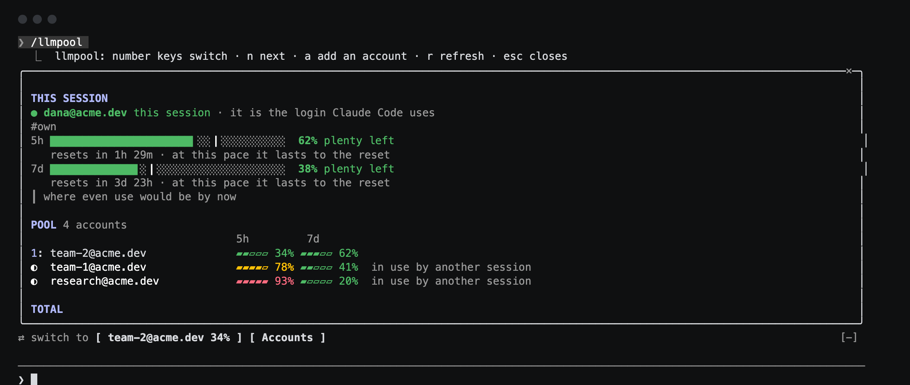
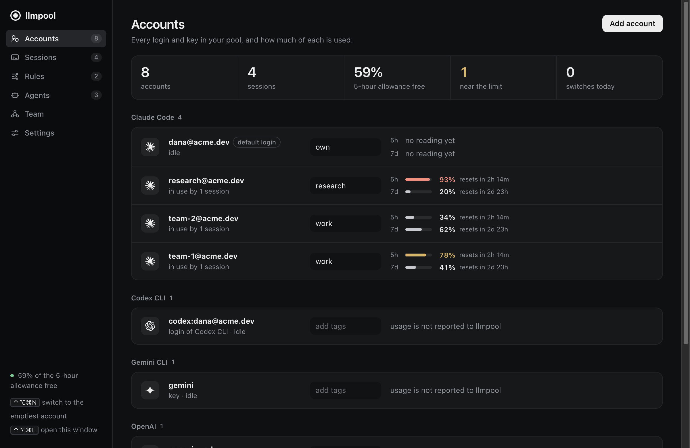
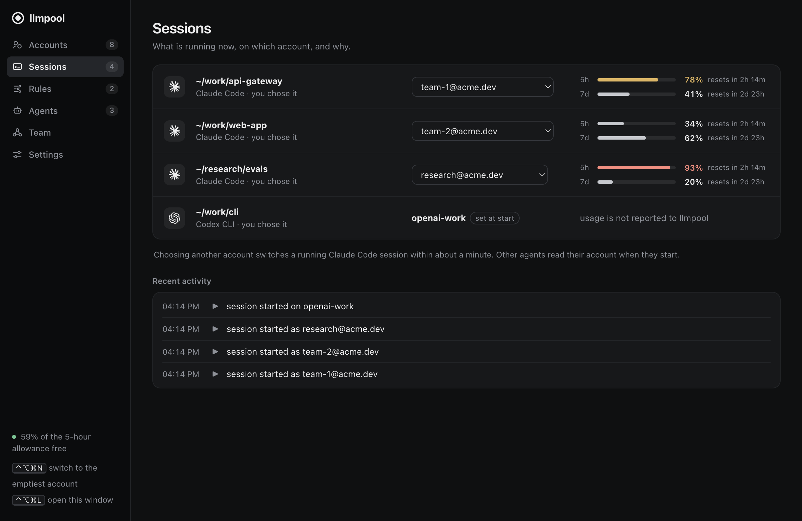
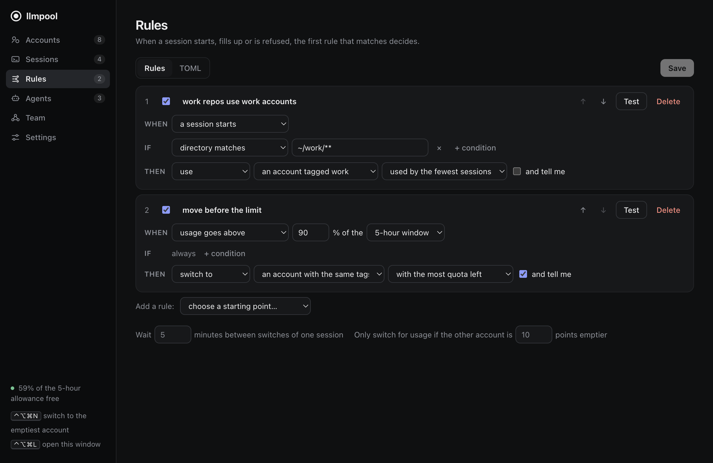
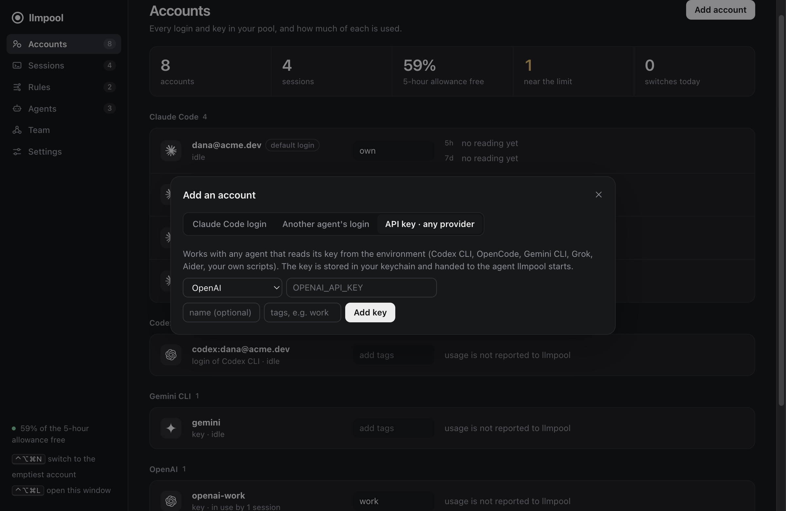
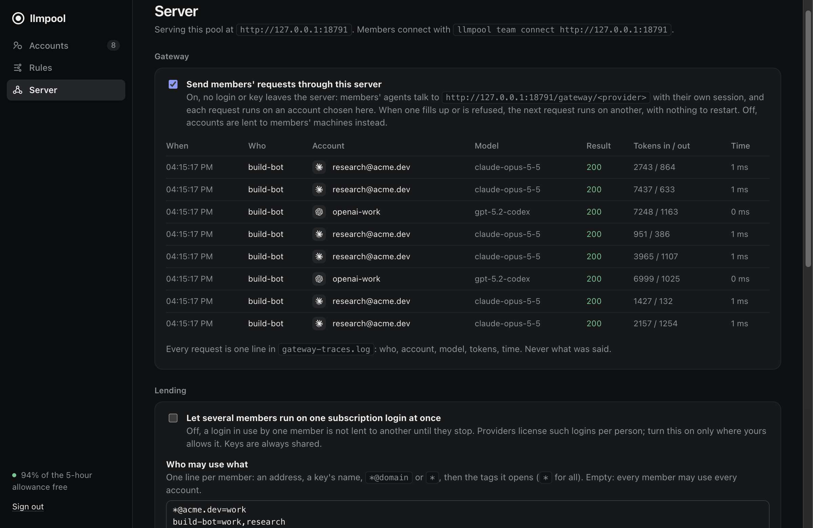

# llmpool

**One pool of LLM accounts for every coding agent you run.** llmpool holds your
logins and keys, starts each agent session on the account your rules pick, and
moves on to another account when one fills up. For a team, one server holds the
pool and can be the gateway every request goes through, so nobody's machine
holds a login.





- **Inside your agent.** In Claude Code, `/llmpool` opens a pane with this
  session's usage, the rest of the pool, and one-key switching. A running
  session moves to another account without restarting.
- **Any agent, any provider.** Codex CLI, OpenCode, Gemini CLI, Grok, Aider or
  your own script start through `llmpool exec`. Accounts are subscription
  logins or API keys for any provider.
- **Rules, not habits.** "Work repos use work accounts", "move before the
  limit", "prefer my own account while it has room": a small TOML file, or the
  editor in the app.
- **A decision model for heavy use.** Optionally, a decision model is shown
  the whole pool, with every teammate's load on it, and decides when a session
  should move and where a new one should start: spreading a team's heavy use
  across accounts before any one runs out, and staying put when moving would
  cost more than it saves. It works inside your rules and sees accounts by
  letter only.
- **A team server, optionally a gateway.** Sign-in with Google or any OpenID
  Connect provider, or API keys. Per-member access, an audit log, a web page to
  run it from, and a Helm chart.

Documentation: **https://shakedaskayo.github.io/llmpool/**

## Install

```bash
curl -fsSL https://raw.githubusercontent.com/shakedaskayo/llmpool/main/scripts/install.sh | sh
```

It downloads the latest release and checks it against its checksum (or builds
from source where there is no ready-made build). On macOS you get the
menu-bar app in `/Applications`, the `llmpool` command, and Claude Code
connected (hooks, status line, `/llmpool`); on Linux, the command. Run it
again to update. `llmpool setup --undo` takes it all back out.

The server: `helm install pool oci://ghcr.io/shakedaskayo/charts/llmpool`, or
the image `ghcr.io/shakedaskayo/llmpool`.

From a checkout: `scripts/install-macos.sh`, or
`cargo install --path crates/llmpool-cli` for the command alone.

Then:

```bash
llmpool doctor                       # what is in place and what is missing
llmpool add claude --from-current    # the login Claude Code has now
llmpool add claude                   # sign in to another account
llmpool add key openai               # a key for any provider
llmpool agents                       # the agents llmpool found on this machine
```

| | |
|---|---|
|  |  |
|  |  |

## Use

```bash
llmpool add claude --from-current --tag personal   # the login Claude Code has now
llmpool add claude --tag work                      # signs in to another account through your browser
llmpool login work@example.com                     # sign in again to an account whose login has ended
llmpool doctor                                     # what is missing, and the command that fixes it
llmpool list                                       # accounts, tags, 5-hour and 7-day usage
llmpool run                                        # start Claude Code on the account a policy picks
llmpool run --account work-1 -- --resume           # or name one; args after -- go to the agent
llmpool sessions
llmpool switch work-2                              # move this session to another account
```

Claude Code started on its own (a terminal without the shim, an editor
extension) is picked up too: it shows in `llmpool sessions`, reports usage,
and can be switched. Such sessions all run on the login in `~/.claude`, so they
switch together. A session started with `llmpool run` gets a login of its own,
which is what lets two accounts work side by side.

Inside Claude Code, `/llmpool` opens a dashboard. The account this session
runs as is drawn large: a meter for the 5-hour and the 7-day window, a mark
(`┃`) on each showing where even use would be by now, a forecast ("at this
pace full in 38m" or "lasts to the reset"), and a trend line of recent
readings. Below it, every other account is one row with small meters for both
windows; press its number to switch. A totals line shows how much of the
pool's combined allowance is free and how often it switched in the last day. The status line shows
the current account and its usage, once; the hint row under the prompt
carries the reminder `/llmpool`. A band appears above the prompt only when
something needs you: the account passes 80% (with a one-press switch to the
account with the most room), or its login is missing or has ended.

The app is the same in a window: Pool, Sessions, and a policy editor where
rules read as sentences and each has a Test button. Its tray menu lists
running sessions; each opens onto the accounts it can switch to. Closing the
window leaves it in the tray.

### Signing in

Signing in is Claude Code's own (`claude auth login`), run in a scratch
profile: your browser opens, and llmpool takes the login into the pool when
you finish. It never sees a password. The same thing is one press away in
`/llmpool` (`a`), in the app (**Sign in…**) and in the tray. If the page shows
a code instead of returning by itself, paste it where you started: the
terminal, the pane or the app.

Whatever is missing is named with its fix on every surface: a login Claude
Code uses that is not in the pool yet, an account whose login has ended,
hooks that are not installed.

### Switching quickly

| Where | How |
|---|---|
| Inside Claude Code | `/llmpool`, then a number key (`n` next, `a` add, `r` refresh); or `/llmpool next`, `/llmpool <account>`, `/llmpool add` |
| Any terminal | `llmpool switch --next`, or `llmpool switch <account>` |
| Anywhere, with the app running | ⌃⌥⌘N switches to the account with the most quota; ⌃⌥⌘L opens the window |
| Tray menu | each session opens onto the accounts it can switch to |
| In the app window | ⌘1–⌘3 sections, ⌘S save rules, ⌘R refresh |

The global key acts on the only running session, or on the login plain
`claude` sessions share; with several separately managed sessions it opens the
window so you can choose.

### Moving to another machine

```bash
llmpool export pool.age          # every account and its login, encrypted with a passphrase
llmpool import pool.age          # on the other machine
```

A login works on one machine at a time. After importing elsewhere, remove the
accounts here, or the two copies invalidate each other.

### Coming from claude-swap

```bash
llmpool import claude-swap
```

Brings over every account claude-swap holds on this machine, except the one
Claude Code is logged in as right now (add that with `--from-current`, which
has the newer copy). An imported login belongs to llmpool from then on:
claude-swap's own copy stops working the next time the login is used.

## Policies

Rules live in one TOML file (`llmpool policy path`), edited by hand or in the
GUI. The first rule that matches wins.

```toml
[[rule]]
name = "acme repos use acme seats"
on = "session_start"
when = { cwd = "~/work/acme/**" }
do = { assign = { tag = "acme", pick = "most_quota" } }

[[rule]]
name = "ask everywhere else"
on = "session_start"
do = { ask = {} }

[[rule]]
name = "swap before the limit"
on = { usage_above = { window = "5h", percent = 90 } }
do = { swap = { tag = "same" }, notify = true }

[[rule]]
name = "swap on rate limit"
on = "rate_limited"
do = { swap = {}, notify = true }
```

| | |
|---|---|
| Triggers | `session_start`, `usage_above`, `rate_limited`, `auth_failed`, `cwd_changed`, `schedule` |
| Conditions | `cwd`, `git_remote`, `model`, `account_tag`, `time` |
| Actions | `assign`, `swap`, `ask`, `notify`, `hold` |
| Pick | `most_quota`, `soonest_reset`, `round_robin` |

A session with no matching `session_start` rule runs on your own login,
untouched. Swaps have a cooldown (5 minutes) and, when driven by usage, need
the target to be 10 points better than the current account; both are in
`[settings]`.

`schedule` fires at a time of day: `on = { schedule = { at = "18:00", days = ["mon", "fri"] } }`.

When a login stops working, the account is marked as needing a new login and
skipped until you add it again.

To add a trigger: implement `Trigger` in
`crates/llmpool-core/src/policy/triggers.rs` and add one line to `all()`.

## Any agent, any provider

Claude Code is the agent llmpool knows best: it switches accounts under a
running session and reads usage. Every other agent works through one command,
`llmpool exec`, which starts it on the account your rules pick.

```bash
llmpool agents                                   # what llmpool found on this machine
llmpool add key openai --tag work                # a key for any provider; typed, never an argument
llmpool add key together --env TOGETHER_API_KEY  # a provider llmpool has not heard of
llmpool add login codex                          # the login Codex CLI (or OpenCode) has now
llmpool add login codex --new                    # sign it in to a second account first
llmpool exec -- codex                            # runs on a codex login if the pool has one, else an OpenAI key
llmpool exec --provider xai -- my-script.sh      # anything that reads a key from its environment
llmpool install agents                           # make plain `codex`, `opencode`, ... go through the pool
```

| | Accounts | Chosen | Switched while running | Usage read |
|---|---|---|---|---|
| Claude Code | its own logins | by rules, at start and after | yes | yes |
| Codex CLI, OpenCode | their own logins, or keys | by rules, at start | no | no |
| Gemini CLI, Grok, Aider, anything else | keys | by rules, at start | no | no |

A key reaches the agent as an environment variable. An account may only set
variables that look like a credential (`*_API_KEY`, `*_TOKEN`, `*_BASE_URL`,
...), so neither a file you import nor a team's server can change what your
agent runs. A session on an agent's own login gets a directory with that login
and links to the rest of the agent's files, so settings and history stay
shared; the login is read back when the session ends, because agents renew
their tokens in place. An agent that is not built in is a few lines in
`harnesses.toml` in llmpool's data directory:

```toml
[[harness]]
name = "mycli"
title = "My CLI"
command = "mycli"
provider = "openrouter"        # the key it reads, if it reads one

[harness.login]                # only if it keeps a login in files
home_env = "MYCLI_HOME"
base = ".mycli"
files = ["auth.json"]
login_args = ["login"]
```

## Team pool

A team can run one llmpool as a server that lends its accounts and rules to
its members. Each member's own llmpool keeps working as before and adds what
the server lends.

**Joining.** In the app: Settings > Team pool, enter the server's address and
sign in, or paste an API key. In a terminal:

```bash
llmpool team connect https://pool.example.com         # opens the sign-in page
llmpool team connect https://pool.example.com --key   # asks for an API key
llmpool team                                          # the link, and any problem with it
llmpool team disconnect
```

In Claude Code: `/llmpool team https://pool.example.com`, `/llmpool team`,
`/llmpool team leave`.

**What a member gets.** The team's accounts appear in the pool tagged `team`,
read-only: they cannot be edited, removed or exported. The team's rules are
tried before the member's own and cannot be changed locally. A member's own
login of the same account always wins over the lent one. Every minute the
member's llmpool tells the server which team accounts it runs on and what
usage it saw, so `least_busy` and `pressure` rules see the whole team.

**What the server keeps.** Refresh tokens never leave it. Members receive
access tokens only, which the server renews before they run out and running
sessions pick up without a restart. Unless `LLMPOOL_SHARE_LOGINS=1`, a
subscription login in use by one member is not lent to another until they stop.

**As a gateway.** With `LLMPOOL_GATEWAY=1` (or the switch on the server's
page), members' agents send their requests to the server and it forwards each
one to the provider on an account it picks. No login or key leaves the server:
a member's agent holds only the member's own session. The server stays on the
account a member was last on while it has room, which keeps the provider's
prompt cache warm, and moves to another when it fills up, is refused, or
fails. Nothing restarts. Each request leaves one line in `gateway-traces.log`
(who, account, model, tokens, time; never what was said), and the server's
page has a Requests page that adds them up by member and account. With the
decision model on, the gateway asks it where a member's requests should go
once their account is past half of a window, off the request's own time, so
heavy use is spread before any account is near its limit. Each request in
flight has a thread of its own (256 at once by default). Subscription logins
and keys both work this way; through a gateway, Claude Code runs as an API
client and its claude.ai connectors are off. `LLMPOOL_UPSTREAM_<PROVIDER>`
moves a provider to your own proxy.

**Inviting people.** The server's page gives an administrator a link to send.
It opens a page that says who invited them, with one line that installs
llmpool, connects it (their browser opens for sign-in) and makes plain
`claude` run on the pool: `... | sh && llmpool team join https://pool.example.com`.

**Putting accounts in.** An administrator adds a key on the server's page, or
from their own machine with one command: `llmpool add claude --to-team` signs
in and puts the login straight into the pool, `llmpool add key openai
--to-team` does the same for a key, and `llmpool team share <account>` (or
**Share with team** in the app) hands over one that is already there. A login
is moved, since only one place can renew it; a key is copied.

**Running the server.**

```bash
LLMPOOL_PUBLIC_URL=https://pool.example.com \
LLMPOOL_OIDC_CLIENT_ID=... LLMPOOL_OIDC_CLIENT_SECRET=... \
LLMPOOL_ALLOWED_DOMAINS=example.com \
llmpool serve --listen 127.0.0.1:8787
```

| Variable | Meaning |
|---|---|
| `LLMPOOL_PUBLIC_URL` | where members reach the server; required |
| `LLMPOOL_OIDC_ISSUER` | any OpenID Connect provider; default `https://accounts.google.com` |
| `LLMPOOL_OIDC_CLIENT_ID`, `LLMPOOL_OIDC_CLIENT_SECRET` | turn sign-in on; register `{public url}/auth/callback` with the provider |
| `LLMPOOL_ALLOWED_DOMAINS`, `LLMPOOL_ALLOWED_EMAILS` | who may sign in; required with sign-in, and checked on every request |
| `LLMPOOL_API_KEYS` | `name:key` pairs (commas or lines), keys of 24+ characters, for members without sign-in |
| `LLMPOOL_SHARE_LOGINS` | `1` lets several members run on one subscription login at once |
| `LLMPOOL_ACCESS` | who may use what, by tag: `*@example.com=work;lead@example.com=*;ci=ci` |
| `LLMPOOL_BLOCKED` | members turned away whatever else admits them |
| `LLMPOOL_ADMINS` | members who may run the server from its web page |
| `LLMPOOL_VAULT_KEY` | 32+ random characters; stored logins are encrypted with it |

**Its own page.** Open the server's address in a browser. Administrators sign
in the way members do and get the same interface as the app, for the server's
pool: accounts (add keys, import logins from an exported file, tag, disable),
the team's rules, and a Server page with who is signed in, who runs on what,
what each member may use, the lending switch and the audit log. What they
change there is kept on the server and wins over the variables above. The
session is a cookie no script can read and no other site can send; exporting
logins and stopping the server cannot be done from a browser.

Every sign-in, refusal, lent account and administrator's change is written to
standard error and `team-audit.log` in the data directory, never with a secret.
Keys of other providers are lent whole. Other agents' own logins (Codex,
OpenCode) are not lent: they renew themselves wherever they run, and a copy on
every member's machine would end them.

Sign-in, API keys, or both. The server speaks plain HTTP: put TLS in front of
it. Members' clients refuse an address that is not `https` unless it is on
their own machine. Accounts and rules are managed on the server with the same
commands as anywhere (`llmpool import`, `llmpool list`, the policy file).

**On Kubernetes.**

```bash
helm install pool oci://ghcr.io/shakedaskayo/charts/llmpool \
  --set publicUrl=https://pool.example.com \
  --set oidc.clientId=... --set oidc.clientSecret=... \
  --set 'oidc.allowedDomains={example.com}' \
  --set ingress.enabled=true --set ingress.className=nginx
```

The chart runs one replica (the pool has one writer) as a non-root user on a
read-only root filesystem, keeps the pool on a volume that survives
`helm uninstall`, takes its secrets from values or from a Secret you manage
(`existingSecret`), and refuses to render without `https`, without anyone who
may connect, or with a short key. The notes it prints say how to import
accounts. Logins on the volume are encrypted with a key the chart makes at
install and keeps in the release's Secret (or takes from yours); the Secret
survives uninstall, because without it the volume cannot be read. `admins`
opens the web page to them; `access` and `blocked` set the starting rules. The pod needs to reach the sign-in provider and the
providers' token endpoints.

## How a swap works

Each managed session runs in its own Claude Code profile
(`CLAUDE_CONFIG_DIR`), with your settings, skills, plugins and history linked
in. To swap, llmpool takes Claude Code's own credential locks, saves the
outgoing login back to its vault (the agent may have rotated the token), and
writes the incoming login into the profile. Claude Code picks it up on its
own. The next prompt carries a note telling you and the model what happened.

A login's refresh token is single-use, so one account is never copied into two
profiles: sessions on the same account share a profile, and a swap moves all
of them together.

Secrets are kept in the OS keychain; account metadata in SQLite under
`~/Library/Application Support/llmpool` (or `$XDG_DATA_HOME/llmpool`).

## Provider terms

Subscription logins are licensed per person, and providers restrict what
third-party tools may do with them. llmpool is built for one person's own
accounts. Check the terms of each provider before using it, and before sharing
a pool with anyone. A team server lends a subscription login to one member at
a time unless told otherwise, for that reason.

## Layout

| Path | What |
|---|---|
| `crates/llmpool-core` | pool model, policy engine, account store, vault |
| `crates/llmpool-adapter-claude` | everything that knows Claude Code's files, locks and settings |
| `crates/llmpool-daemon` | session registry, swap logic, local HTTP API |
| `crates/llmpool-daemon/src/team_server.rs`, `team.rs` | the team server and a member's link to one |
| `Dockerfile`, `deploy/helm/llmpool` | the server as a container and a Helm chart |
| `crates/llmpool-cli` | the `llmpool` binary |
| `crates/llmpool-gui` | Tauri window and tray |
| `claude-plugin/llmpool` | the Claude Code mod, embedded in the binary |
| `crates/llmpool-core/src/harness.rs`, `providers.rs` | the agents and providers llmpool knows, as data |
| `scripts/dev-ui.py` | the app's interface in a browser against a daemon, for design work and browser tests |
| `docs/superpowers/specs` | design |

## Development

```bash
cargo fmt --all && cargo clippy --workspace --all-targets -- -D warnings
cargo test --workspace
claude plugin validate claude-plugin/llmpool && claude plugin test claude-plugin/llmpool
```

Tests never touch a real login: they run against temporary home directories
with a file vault. To try the binary the same way, set `LLMPOOL_HOME`, `HOME`,
`LLMPOOL_FILE_VAULT=1`, `LLMPOOL_NO_CLAUDE_KEYCHAIN=1` and `LLMPOOL_NO_NOTIFY=1`.

## Not built yet

Switching accounts under a running agent other than Claude Code, and reading
usage for anything but Claude subscriptions. More than one server process for
one pool: a login's refresh token works once, so the pool has one writer by
design. Windows is not supported.

## Licence

MIT. See `LICENSE`.
